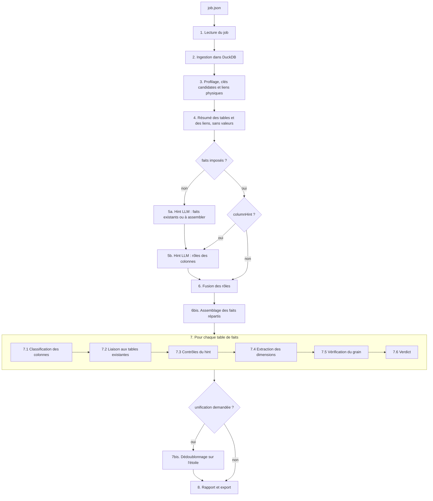
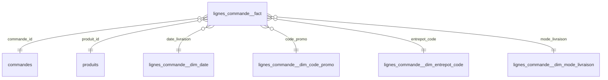

# Les étapes de la pipeline kawakiriv3

Ce document suit un run de bout en bout, de la lecture du job jusqu'aux
fichiers de sortie. Pour chaque étape, il indique ce qui entre, ce qui
sort, le module qui s'en charge et les règles de décision.

Pour le principe général (pourquoi partir du fait), voir le
[README](README.md).

## Vue d'ensemble



L'exemple qui sert de fil rouge est le dataset
[commerce](examples/commerce/README.md), avec `lignes_commande` comme fait.

---

## 1. Lecture du job

**Module** : [run_v3.py](run_v3.py), [jobPayload.py](kawakiriv3/jobPayload.py)

```bash
py -3.12 run_v3.py examples/job_commerce.json
```

Le job est un fichier JSON, validé par pydantic (`JobPayload`) :

| Champ | Rôle |
|---|---|
| `source` | le connecteur et ses paramètres (`kind: csv`, `clickhouse`…) |
| `tables` | les tables à charger, éventuellement restreintes à certaines colonnes (absent = tout) |
| `businessNeed` | le besoin métier, en langage naturel : c'est ce que lit le LLM pour choisir le fait |
| `contextType` | le contexte métier (« JDE AR », « e-commerce »…), transmis au LLM |
| `factTables` | les tables de faits imposées : le LLM ne les choisit plus |
| `tableDescriptions` | des descriptions de tables et de colonnes, transmises au LLM |
| `columnRoles` | par table : `keys`, `measures`, `excluded`, déclarés par l'appelant |
| `columnHint` | demander ou non au LLM les rôles des colonnes (vrai par défaut) |
| `assembledFacts` | les faits à assembler, imposés : ancre, mesures, clés (voir l'étape 6bis) |
| `declaredLinks`, `forbiddenLinks` | liens physiques imposés ou interdits, `"table.colonne -> table.colonne"` |
| `linkHint`, `linkCachePath` | arbitrage LLM des liens douteux (vrai par défaut), fichier du cache des verdicts |
| `duckDbPath`, `outputDir` | la base de travail et le dossier de sortie |

## 2. Ingestion dans DuckDB

**Module** : [Sources/](kawakiriv3/Sources/), `KawakiriV3Pipeline.ingest`

- `buildSource(job.source)` instancie le connecteur selon `kind`. Tous
  implémentent `SourceConnector` (`listTables`, `listColumns`,
  `fetchDataFrame`, `loadInto`, `close`).
- La base DuckDB est vidée, puis chaque table source est copiée dedans :
  - **CSV** : `read_csv` natif de DuckDB, une table par fichier, fichiers
    triés par nom ;
  - **ClickHouse** : lecture via `clickhouse-connect` (avec `rowLimit`
    optionnel), puis chargement du DataFrame.
- Le nom DuckDB est normalisé (`duckDbTableName`). Deux tables sources qui
  tomberaient sur le même nom font échouer le run.

**Sortie** : `{table source: table DuckDB}`. Toute la suite tourne sur
DuckDB, quelle que soit la source. La source n'est plus jamais lue.

## 3. Profilage et clés candidates

**Module** : [Schema/](kawakiriv3/Schema/), [Profiling/](kawakiriv3/Profiling/),
[PrimaryKey/](kawakiriv3/PrimaryKey/) (repris de la v2)

`SchemaEngine(db, tables).build()` profile **chaque** table chargée, pas
seulement le fait :
- par colonne : type SQL, nombre de valeurs distinctes, taux de nulls,
  unicité, format de date dominant (`%d/%m/%Y`…), plage numérique ;
- par table : les clés primaires candidates
  (`inferAllPrimaryKeyCandidates`).

Les autres tables doivent être profilées parce que ce sont les cibles
possibles des liens de l'étape 7.2.

**Liens physiques** ([FactAssembly/linkGraph.py](kawakiriv3/FactAssembly/linkGraph.py)).
Chaque colonne de chaque table, sauf les décimales, est testée contre les
clés candidates des autres tables (au moins 80 % de recouvrement). Un lien a
un sens (`source -> cible`) et une cardinalité : `N:1`, ou `1:1` quand la
colonne source est elle-même unique. Chaque candidat est décidé en trois
étages :

| étage | décision | exemple sur `marge` ou `jde_liens` |
|---|---|---|
| noms | accepté si les noms concordent sur un concept non générique | `lignes_commande.commande_id -> commandes.commande_id` |
| statistiques | 1:1 couvert dans les deux sens, hors plage dense : accepté | une extension 1:1 nommée autrement |
| statistiques | 1:1 couvert dans un seul sens (moins de 50 % dans l'autre) : refusé | `clients.client_id -> lignes_commande.ligne_id`, 4 % dans l'autre sens |
| noms | une autre cible de la même colonne a un nom concordant : refusé | `commandes.client_id -> lignes_commande.ligne_id` |
| LLM | les liens douteux, en un seul appel, puis en cache | `f03b11.RPAN8 -> f0101.ABAN8` accepté, `lignes_commande.quantite -> clients.client_id` refusé |
| appelant | `declaredLinks` / `forbiddenLinks` du job, toujours le dernier mot | |

L'arbitrage LLM n'a lieu que dans un run qui fait déjà appel au LLM ; un
verdict en cache est toujours réutilisé ; un lien douteux que personne
n'arbitre est refusé par prudence.

Sur `marge`, 13 liens sont retenus : 18 candidats sont décidés sans appel,
5 coïncidences (`quantite`, `stock_fin_jour`) sont refusées par le LLM.

## 4. Résumé des tables

**Module** : [FactHint/tablesSummary.py](kawakiriv3/FactHint/tablesSummary.py)

`buildTablesSummary` produit ce que le LLM verra : pour chaque table, son
nombre de lignes, ses colonnes (type, cardinalité, taux de nulls, unicité)
et les descriptions du job.

Les liens physiques de l'étape 3 l'accompagnent (`physicalLinks`) : tables,
colonnes, cardinalité, couverture.

**Aucune valeur réelle n'y figure**, par construction : seulement la
structure et des statistiques. C'est la garantie RGPD de la v3.

## 5. Hint LLM

**Modules** : [FactHint/factHintAdvisor.py](kawakiriv3/FactHint/factHintAdvisor.py)
côté v3, graphe `build_fact_hint_graph` côté `kawakiri-langgraph`

Un seul appel HTTP : `POST /propose-fact-tables` (URL lue dans
`LANGGRAPH_ADVISOR_URL`, sinon `http://localhost:8001`). Le graphe LangGraph
enchaîne deux nœuds :

```
START ─► propose_fact_tables ─► classify_fact_columns × N (en parallèle) ─► END
   └──── (faits imposés) ───────────┘
```

### 5a. Choix des tables de faits (`propose_fact_tables`)

- Le LLM reçoit le besoin métier, le contexte et le résumé des tables.
- Il renvoie une ou plusieurs tables, la plus pertinente en premier, chacune
  avec une justification. Il n'en propose plusieurs que si le besoin couvre
  plusieurs processus métier distincts (ventes **et** retours, par exemple).
- Si les mesures demandées sont réparties sur plusieurs tables, il propose
  plutôt un **fait assemblé** (`assembledFacts`) : l'ancre, les mesures
  avec leur additivité, les clés à descendre et, pour une mesure plus
  grossière que le grain, une règle de répartition. Les noms de tables et de
  colonnes sont vérifiés par le schéma, colonne par colonne.
- Le nombre de faits est donc celui que renvoie le LLM.
- Garde-fous :
  - le schéma de l'outil forcé restreint le nom de table aux tables du
    payload (`Literal`) ;
  - une réponse invalide est renvoyée au modèle avec l'erreur, pour une
    nouvelle tentative ;
  - côté v3, chaque nom est revérifié ; un nom inconnu est écarté et listé
    dans `rejectedHintTables`.

Ce nœud est sauté si le job impose `factTables`.

### 5b. Rôles des colonnes (`classify_fact_columns`)

Un agent par table de faits, en parallèle (fan-out `Send`). Il liste les
colonnes que les statistiques ne savent pas trancher :
- `keyColumns` : des clés de dimension (typiquement des entiers JDE comme
  `RPAN8`, qui ne suivent aucune convention de nom) ;
- `measureColumns` : des mesures ;
- `technicalColumns` : des métadonnées de chargement ou d'audit.

Chaque colonne figure au plus dans une liste, et son nom est restreint aux
colonnes de la table. Côté v3, un nom inconnu est écarté et listé dans
`rejectedColumnNames`.

### Quand le LLM est-il appelé ?

| `factTables` | `columnHint` | Appel LLM |
|---|---|---|
| absent | vrai | choix des faits + rôles des colonnes |
| absent | faux | choix des faits seulement |
| imposé | vrai | rôles des colonnes seulement |
| imposé | faux | **aucun** |
| `assembledFacts` imposés seuls | — | **aucun** |

Un fait assemblé n'a pas d'étape 5b : ses mesures et ses clés donnent déjà
les rôles de ses colonnes.

Le conseiller ne lève jamais d'exception : une panne du service est
remontée dans `factHintError` ou `columnRolesErrors`, et le run continue
avec ce qu'il a.

## 6. Fusion des rôles de colonnes

**Module** : [FactAnalysis/columnRoles.py](kawakiriv3/FactAnalysis/columnRoles.py)

Pour chaque table de faits, `ColumnRoles.fromLlm(...)` est construit à
partir de la réponse du LLM, puis surchargé **colonne par colonne** par les
`columnRoles` du job (`overriddenBy`). L'appelant gagne toujours sur le
LLM.

## 6bis. Assemblage des faits répartis

**Module** : [FactAssembly/factAssembler.py](kawakiriv3/FactAssembly/factAssembler.py)

Pour chaque fait à assembler, le code construit une table
`<nom du fait>` avec **une ligne par ligne de l'ancre** :

1. **Relation de chaque table à l'ancre**, par les plus courts chemins du
   graphe :
   - chemin de liens 1:1, dans un sens ou dans l'autre → **même grain** ;
   - chemin depuis l'ancre avec un lien N:1 → **plus grossière** ;
   - chemin vers l'ancre avec un lien N:1 → **plus fine** ;
   - aucun chemin → **hors périmètre**.

   Suivre un lien envoie chaque ligne vers **une seule** ligne de la cible :
   un chemin depuis l'ancre ne démultiplie jamais ses lignes.
2. **Ce que chaque relation permet** :

   | relation | mesure | clé |
   |---|---|---|
   | même grain | copiée (`LEFT JOIN` : une ligne absente reste nulle) | copiée |
   | plus grossière | additive : répartie (`egal`, ou `prorata:<mesure>` avec repli à parts égales si les poids sont nuls), sinon **refusée** ; non additive : répétée ; semi-additive : refusée | copiée |
   | plus fine | agrégée **avant** la jointure (`sum` par défaut si additive ; `count`, `min`, `max`, `avg` sur demande), 0 quand la ligne n'a aucune ligne fine | refusée |
   | hors périmètre | refusée | refusée |

3. **Contrôles**, chacun devient un avertissement :
   - le fait assemblé a exactement le nombre de lignes de l'ancre ;
   - **réconciliation** : pour chaque mesure additive (et chaque `count`),
     le total du fait assemblé est comparé au total de la table source. Un
     écart négatif signale des lignes source rattachées à aucune ligne du
     grain (orphelines), un écart positif des lignes comptées deux fois ;
   - chaque élément refusé, avec sa raison ;
   - chaque table atteinte par plusieurs chemins aussi courts.

La table assemblée est profilée, puis passe à l'étape 7 comme une table
existante, avec les rôles de colonnes issus de l'assemblage. L'ancre et les
tables au même grain ou plus fines sont « fondues » dans le fait : elles ne
sont plus des cibles de liens, ni des sources de l'avertissement « table
plus fine ».

Une table plus grossière jointe **directement** depuis l'ancre, dont
l'assemblage a recopié des colonnes, est l'**en-tête** des lignes (une
commande, un ticket : `AssemblyResult.headerTables`). Son contenu est dans le
fait : elle n'est pas une cible de liens pour lui, et la colonne de l'ancre
qui la joint (`commande_id`, `transaction_id`) est le numéro du document,
une colonne **dégénérée**, même si la spec la nommait comme clé. Elle reste
donc hors du grain, et des lignes identiques dans un même ticket donnent la
note « grain à la ligne » au lieu d'un avertissement. Les tables atteintes
plus loin par l'en-tête (`clients` derrière `commandes`) restent des cibles :
la clé client recopiée reste liée.

Sur `marge` : `tarification_lignes` et `couts_achat` sont au même grain,
`expeditions` est plus fine, `commandes` est plus grossière et
`stocks_journaliers` est hors périmètre. Les frais de port, répartis au
prorata de `montant_ht`, se réconcilient au centime. Les 6 colis orphelins
ressortent en écart sur le coût de transport et le poids.

## 7. Analyse d'une table de faits

**Module** : [FactAnalysis/factAnalyzer.py](kawakiriv3/FactAnalysis/factAnalyzer.py)

`FactAnalyzer(...).analyze()` enchaîne les étapes suivantes sur **une**
table de faits et produit un `FactModel`. Elle tourne une fois par fait.

### 7.1 Classification des colonnes

**Module** : [FactAnalysis/columnClassifier.py](kawakiriv3/FactAnalysis/columnClassifier.py)

Chaque colonne reçoit un rôle initial. Les règles sont appliquées dans cet
ordre, la première qui s'applique gagne :

| # | Règle | Rôle |
|---|---|---|
| 1 | entièrement vide | `empty` (écartée) |
| 2 | une seule valeur non nulle | `constant` (écartée) |
| 3 | exclue par l'appelant ou le LLM | `technical` (écartée) |
| 4 | nom technique (`dbt_*`, `_airbyte_*`, `LOADED_AT`, `FILE_NAME`…), sauf rôle explicite | `technical` (écartée) |
| 5 | désignée mesure, et numérique | `measure` |
| 6 | unique sur chaque ligne | `row_identifier` : **les statistiques ont le dernier mot**, même face à une clé désignée |
| 7 | désignée clé | `key_candidate` (ou `date` si c'est une date) |
| 8 | numérique décimal | `measure` |
| 9 | date ou horodatage (ou texte au format date) | `date` |
| 10 | entier nommé comme une clé (`*_id`, `*_code`, `RefNum`…) | `key_candidate` |
| 10 bis | autre entier : clé provisoire, qui ne sera liée que si les noms corroborent le lien, et redeviendra mesure sinon (étape 7.4) | `key_candidate` (repli `measure`) |
| 11 | texte presque unique (≥ 90 % de valeurs distinctes) | `descriptive` |
| 12 | le reste : valeur discrète qui se répète | `key_candidate` |

Chaque colonne garde la trace de **qui** a décidé (`roleSource`) :
appelant, LLM, motif de nom ou statistiques.

Sur `lignes_commande` : `ligne_id` et `ligne_uuid` sont des identifiants de
ligne, `devise` est constante, `code_tva_legacy` est vide, `montant_ligne`
est une mesure, `date_livraison` une date, `commande_id` et `code_promo` des
clés candidates.

### 7.2 Liaison aux tables existantes

**Module** : [FactAnalysis/factLinker.py](kawakiriv3/FactAnalysis/factLinker.py),
[SourceJoin/](kawakiriv3/SourceJoin/)

Chaque clé candidate du fait est testée contre les clés primaires
candidates des **autres** tables :
- seules les colonnes du fait sont sources, et seules les autres tables sont
  cibles : on ne teste jamais toutes les paires de tables ;
- un lien demande au moins 95 % de recouvrement des valeurs du fait ;
- un entier qui n'est pas nommé comme une clé n'est lié que si le nom de la
  cible concorde. Sinon, `quantite` (1 à 10) se lierait à `magasin_id`
  (1 à 12) par pure coïncidence de plage ;
- les verdicts du graphe des liens (étape 3) passent avant : un lien que le
  LLM ou le job a accepté est lié même sans nom concordant (`RPAN8 ->
  f0101.ABAN8`), un lien qu'ils ont refusé n'est jamais lié ;
- si plusieurs cibles conviennent, la meilleure est retenue et le lien est
  marqué **ambigu** ;
- une table peut se lier à elle-même (`factures.facture_origine_id ->
  factures.facture_id`, l'avoir qui référence sa facture d'origine), mais
  seulement sur une colonne nullable. Une colonne jamais nulle de la même
  table (une composante de clé JD Edwards, `RPDOC`/`RPKCO`...) n'est jamais
  candidate à l'auto-référence : sinon toute clé obligatoire se
  recouvrirait trivialement avec elle-même.

Une colonne liée devient `foreign_key` : elle reste dans le fait et pointe
vers la table existante.

Sur `lignes_commande` : `commande_id → commandes`, `produit_id → produits`.

### 7.3 Contrôles du hint

**Module** : [FactAnalysis/factHintCheck.py](kawakiriv3/FactAnalysis/factHintCheck.py)

On vérifie que la table choisie ressemble bien à un fait :
- **pas de mesure** : un fait sans rien à agréger est suspect ;
- **motif en-tête / lignes** : une autre table, plus volumineuse, référence
  le fait. Le grain demandé est sans doute plus fin (c'est le piège
  `commandes` prise comme fait) ;
- **dimension plus grosse que le fait** : une table liée a plus de lignes
  que le fait ;
- **historique SCD non filtré** : une paire de colonnes `*_valid_from` /
  `*_valid_to` (convention dbt snapshot, ou équivalent) encore variable --
  signe qu'une même entité peut apparaître en plusieurs lignes et que ses
  mesures seraient comptées plusieurs fois si la version courante n'est pas
  filtrée (à la source, ou via `rowFilters`). Silencieux une fois que
  `*_valid_to` s'est réduit à une seule valeur (le filtre a été appliqué).

Ces contrôles produisent des avertissements, jamais un rejet.

### 7.4 Extraction des dimensions

**Module** : [FactAnalysis/dimensionExtractor.py](kawakiriv3/FactAnalysis/dimensionExtractor.py)

Tout ce qui ne s'est lié à rien reçoit son rôle final :
- **identifiant de ligne, texte descriptif** → `degenerate` : reste dans le
  fait, hors grain (numéro de ticket, commentaire) ;
- **entier sans lien corroboré**, non nommé comme une clé → `measure` ;
- **clé candidate non liée** → extraite dans une dimension générée.

**Regroupement par dépendance fonctionnelle.** Les clés sont parcourues de
la plus granulaire (le plus de valeurs distinctes) à la moins granulaire.
Pour chacune, on teste quelles autres colonnes elle détermine :
`code_promo → libelle_promo` donne **une** dimension
`lignes_commande__dim_code_promo`, et `libelle_promo` quitte le fait
(`moved_attribute`). Ne peuvent pas être absorbées :
- les dates ;
- les clés désignées par l'appelant ou le LLM : une dépendance observée sur
  les données (nulls ignorés) peut être fortuite.

**Calendrier partagé.** Toutes les dates non liées rejoignent une seule
dimension, `<fait>__dim_date` (`date_key`, `annee`, `trimestre`, `mois`,
`jour`, `jour_semaine`), construite sur l'union de leurs jours. Une date
stockée en texte est lue avec son format dominant ; un horodatage se joint
par sa partie date.

**Colonnes dérivées du calendrier.** Une clé candidate -- ou une mesure
désignée par le LLM, jamais par l'appelant -- qui est une fonction
déterministe d'une des dates du fait (`semaine_iso = week(date_evenement)`)
n'apporte rien de son cru : elle est fondue dans le calendrier partagé comme
attribut dérivé au lieu d'être dupliquée dans sa propre dimension, ou
sommée à tort comme mesure.

**Écriture dans DuckDB.**
- une table par dimension générée : `<fait>__dim_<clé>`, dédoublonnée sur
  la clé, sans la valeur nulle ;
- le fait réécrit, `<fait>__fact` : toutes les colonnes sauf les attributs
  déplacés et les colonnes écartées (vides, constantes, techniques).

La table source n'est jamais modifiée.

### 7.5 Vérification du grain

**Module** : [FactAnalysis/grainVerifier.py](kawakiriv3/FactAnalysis/grainVerifier.py)

Le grain est l'ensemble des clés du fait : les clés étrangères, les clés
extraites et les dates. Les mesures, les colonnes dégénérées et les colonnes
écartées n'en font pas partie.

« Grain = toutes les clés » est une hypothèse, on la **mesure** :
`COUNT(*)` contre `COUNT(DISTINCT ROW(clés…))` sur `<fait>__fact`.
- une clé nulle est le membre « inconnu » de sa dimension : elle compte
  comme une valeur, donc deux lignes inconnues identiques sont un doublon ;
- les lignes avec au moins une clé nulle sont comptées à part
  (`unknownKeyRows`), pour information ;
- si le grain n'est pas unique, on cherche une colonne dégénérée qui le
  rendrait unique (`completingColumns`), par exemple `retour_id` sur
  `retours` ;
- si de plus chaque doublon se répète à l'intérieur d'un même document (le
  même article scanné deux fois sur un ticket : mêmes clés, même
  `transaction_id`, deux numéros de ligne), le fait est au grain de la ligne
  (`repeatedWithin`) : c'est une note, pas un avertissement. Des doublons
  entre documents différents, ou sans document, restent un avertissement.

### 7.6 Verdict

| Verdict | Condition |
|---|---|
| `ok` | grain unique (ou unique à la ligne, voir 7.5), aucun avertissement |
| `needs_review` | au moins un avertissement (contrôle du hint, lien ambigu, grain non unique) |
| `rejected` | aucune clé de dimension : pas de grain du tout |

## 7bis. Post-traitement : le dédoublonnage sur l'étoile

**Modules** : [pipeline.py](kawakiriv3/pipeline.py) (`_postProcess`),
[StarUnification/](kawakiriv3/StarUnification/) (qui pilote le moteur de
[DerivedTables/](kawakiriv3/DerivedTables/)), nœud `propose_unifications` de
langgraph_advisor.

Deux temps. **Temps 1, l'étoile** : §2 à §7, une étoile par fait, chaque
source seule. **Temps 2, l'unification**, seulement si quelque chose la
demande :

- **le job** déclare `unification` : elle est appliquée telle quelle, sans
  appel LLM ;
- **sinon, le hint** (§5a) répond `unificationRequested: true` quand le
  besoin demande d'unifier des entités ou de réunir des faits de plusieurs
  sources. Un appel `POST /propose-unifications` reçoit alors le catalogue
  des étoiles et décrit l'unification. Le LLM part de ce que le besoin
  demande, puis de ses conséquences : des clients unifiés appellent en
  général un fait unique des ventes ; des produits sans identifiant commun ne
  sont pas unifiés, seulement alignés.

Le temps 2 ne lit que les tables de l'étoile et les rôles déjà décidés :
aucune nouvelle classification, aucune recherche de liens, aucun rôle
recalculé. Il ne peut donc pas casser une étoile validée. Il reprend aussi
l'étoile telle quelle, défauts compris : si l'étoile magasin relie
`transaction_id` à `shop_transactions`, le fait réuni garde cette dimension,
vide pour le web. On corrige l'étoile, pas l'unification.

### 7bis.1 Le catalogue des étoiles

[starCatalog.py](kawakiriv3/StarUnification/starCatalog.py) lit les
`FactModel` : par étoile, le fait (`<fait>__fact`) et, par colonne, son rôle
(clé, mesure, dégénérée), son additivité et la dimension vers laquelle elle
pointe ; par dimension, sa table, sa clé, ses colonnes et son type :

| type | exemple | clé |
|---|---|---|
| `linked` : table source reliée | `web_customers`, via `web_sales.customer_id` | la colonne cible du lien (`id`) |
| `extracted` : dimension extraite | `web_sales__dim_product_name` | la colonne extraite |
| `calendar` : calendrier | `web_sales__dim_date` | `date_key` |

Son résumé est ce que voit le LLM : noms, types, rôles, nombres de lignes et
taux de nulls, **aucune valeur réelle** (RGPD : aucun appel LLM ne reçoit de valeur).

### 7bis.2 La spec, en termes d'étoile

[unificationSpec.py](kawakiriv3/StarUnification/unificationSpec.py), même
forme dans le job et dans la réponse du LLM :

```json
"unification": {
  "dimensions": [{
    "name": "clients_unifies", "idColumn": "client_unifie_id",
    "sources": [
      {"dimension": "loyalty_cards", "label": "magasin",
       "columnMapping": {"email": "client_email", "telephone": "client_phone", "nom": "client_nom"}},
      {"dimension": "web_customers", "label": "web",
       "columnMapping": {"email": "email", "telephone": "phone", "nom": "last_name"}}],
    "matchColumns": ["email", "telephone"],
    "priorityColumn": null, "sourcePriority": ["web", "magasin"]
  }],
  "facts": [{
    "name": "ventes_unifiees", "labelColumn": "canal",
    "sources": [
      {"fact": "web_sales", "label": "web", "columnMapping": {"quantite": "quantity", "produit": "product_name"}},
      {"fact": "shop_sales", "label": "magasin", "columnMapping": {"quantite": "qty", "produit": "item_name"}}],
    "computedMeasures": [{"name": "montant", "multiply": ["quantite", "prix_unitaire"]}],
    "nonAdditiveMeasures": ["prix_unitaire"]
  }]
}
```

- Une **dimension unifiée** a une source par dimension de l'étoile, chacune
  avec son libellé d'origine (obligatoire). `columnMapping` n'aligne que les
  attributs de même sens ; toute autre colonne est gardée telle quelle
  (suffixée du libellé si son nom est déjà une colonne cible).
- L'**identifiant d'origine** de chaque source est la clé de sa dimension,
  connue par l'étoile : il est rangé sous une même colonne (celle que le
  mapping lui donne, sinon le nom commun des clés, sinon `cle_source`).
- Un **fait réuni** a une source par fait d'étoile, nommé comme le job ou le
  hint le nomme ; `columnMapping` lit les colonnes du fait de l'étoile.
- **Validation** (`errorsAgainst`) : la spec ne vérifie que des noms du
  catalogue (dimensions, faits, colonnes ; un calendrier ne s'unifie pas ;
  une dimension ou un fait ne sert qu'une fois ; la colonne de priorité est
  une date ou un nombre). Une spec invalide est ignorée avec sa raison.

Les noms des dimensions et des faits passent par le renommage DuckDB du job
(`UnificationSpec.renamed`).

### 7bis.3 Les dimensions unifiées

[dimensionUnifier.py](kawakiriv3/StarUnification/dimensionUnifier.py) écrit
deux specs pour [derivedTableBuilder.py](kawakiriv3/DerivedTables/derivedTableBuilder.py) :

1. `<nom>__union` : l'union des tables de dimension, toutes leurs colonnes,
   avec la colonne d'origine (`origine`) ;
2. `<nom>` : le dédoublonnage de cette union. Deux lignes sont la même
   identité dès qu'elles partagent une vraie valeur (ni nulle, ni vide) sur
   une colonne de rapprochement, de proche en proche. Chaque attribut vient
   de la **fiche prioritaire** : la plus récente selon `priorityColumn` (une
   date de dernière modification), puis la première source de
   `sourcePriority`, puis l'ordre des lignes ; une valeur vide est complétée
   par la fiche suivante. La règle appliquée est dans le rapport.

La table unifiée porte par source `present_<source>` et `<clé>_<source>`
(`client_ref_web`, `client_ref_boutique`). `<nom>__correspondance` relie
chaque ligne source, par son libellé et sa clé, à son id unifié.

### 7bis.4 Le remplacement des clés

[keyRemapper.py](kawakiriv3/StarUnification/keyRemapper.py) : pour chaque
fait dont une clé pointe vers une dimension fondue, `<fait>__fact_unifie` est
le fait de l'étoile où cette clé est **remplacée, à la même place**, par l'id
unifié, trouvé dans la correspondance sur la paire (source, valeur de clé).
Même nombre de lignes, même ordre. Une clé sans correspondance donne un id
nul (le membre inconnu) et un avertissement chiffré.

Le `FactModel` est copié, pas réanalysé : seuls la clé remplacée, son lien
(vers la dimension unifiée) et la dimension qu'elle quitte changent. Le
grain est vérifié à nouveau sur les mêmes rôles (deux clients fusionnés
peuvent rendre deux lignes égales).

### 7bis.5 Les faits réunis

[factGatherer.py](kawakiriv3/StarUnification/factGatherer.py) fait l'union
des faits (remappés s'ils l'ont été) dans `<nom>__fact`, avec la colonne
d'origine, les mesures calculées et la liste des mesures non additives. Une
colonne cible que chaque source alimente avec le même id unifié prend son
nom (`client_unifie_id`). Les rôles sont déduits de l'étoile, jamais
recalculés :

| dans les faits réunis | dans le fait réuni |
|---|---|
| mesure partout | mesure (non additive si l'une l'est ou si la spec le dit) |
| date partout | clé vers un calendrier commun `<nom>__dim_date` (les jours des calendriers des étoiles et des dates du fait) |
| dégénérée partout | dégénérée |
| clé vers la même table (dimension unifiée, table partagée) | clé vers cette table |
| clé extraite alignée (le produit) | clé vers une dimension conforme `<nom>__dim_<colonne>` : union des dimensions extraites, par valeur |
| clé présente dans un seul fait (mode de paiement) | clé vers la dimension de ce fait, vide pour les autres sources |
| rôles qui divergent | dégénérée, avec un avertissement |

La colonne d'origine est une clé vers sa petite dimension
(`<nom>__dim_canal`) ; une mesure calculée est une mesure (« calculée :
quantite x prix_unitaire »). Le grain est vérifié avec le
[grainVerifier.py](kawakiriv3/FactAnalysis/grainVerifier.py) existant, sur
les rôles repris ; la note « grain à la ligne » est conservée. Le résultat
est un `FactModel` construit directement, sans `FactAnalyzer`.

### 7bis.6 Le résultat

Dans `results["models"]`, un fait non touché garde son étoile telle quelle ;
un fait remappé est remplacé par sa copie `__fact_unifie` ; les faits réunis
sont remplacés par le fait réuni. Les étoiles remplacées passent dans
`results["replacedModels"]` et restent dans DuckDB. `results["unification"]`
porte la décision (`source`, `reasoning`, `rejected`), puis `dimensions`,
`remappedKeys` et `facts`, repris par le rapport (« Étape 2 : dédoublonnage
sur l'étoile »).

## 8. Rapport et export

**Module** : [report.py](kawakiriv3/report.py)

Le terminal affiche un résumé par fait (grain, clés inconnues, liens,
dimensions extraites, mesures, colonnes techniques, avertissements). Dans
`outputDir` :
- `v3_results.json` : tout le résultat, sérialisé ;
- `v3_report.md` :
  - le raisonnement du LLM et les éventuelles erreurs ;
  - par fait : un diagramme Mermaid de l'étoile, le verdict, le grain ;
  - le tableau des colonnes : rôle final, raison, et qui a décidé.

Les tables de l'étoile (`<fait>__fact`, `<fait>__dim_*`) restent dans la
base DuckDB du job, interrogeables directement.

Dans chaque diagramme, une table source liée (`clients`, `plans`...) est
nommée `<fait>.<table>` plutôt que par son seul nom : plusieurs faits du
même rapport se liant souvent à la même table, répéter un nom d'entité
identique dans deux diagrammes `erDiagram` d'un même fichier Markdown fait
planter certains rendus Mermaid (ex. l'aperçu Markdown de VS Code --
`Cannot read properties of null (reading 'getAttribute')`), qui ne
réinitialisent pas leur état entre deux diagrammes de la même page.

## Résultat sur `lignes_commande`



Grain `(commande_id, produit_id, date_livraison, code_promo, entrepot_code,
mode_livraison)`, unique, verdict **ok**.
