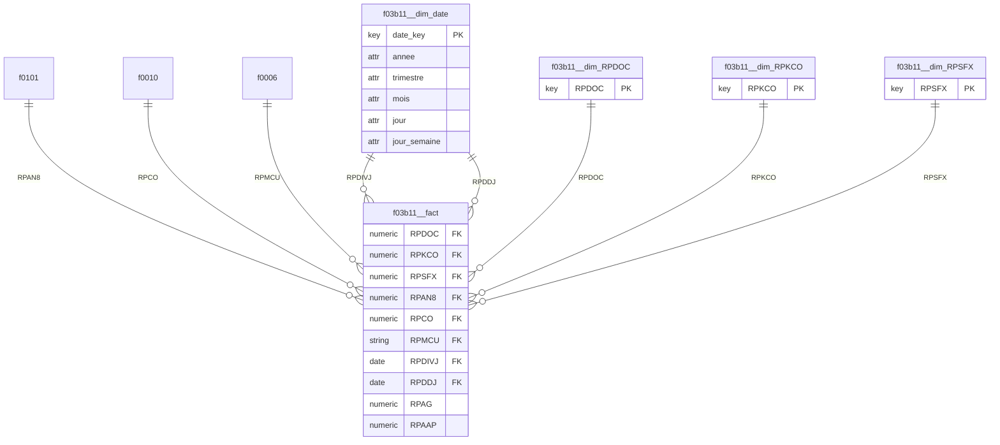

# Kawakiri v3 -- rapport

**Besoin metier** : Analyser les creances clients : montants factures et restant dus par client, societe, centre de cout et date de facture.

**Choix des tables de faits** : hint LLM

> Le besoin porte sur l'analyse des creances clients (montants factures et restant dus) par client, societe, centre de cout et date de facture. La table f03b11 (AR detail - open amounts) contient directement les lignes de factures clients avec les montants (RPAG = montant brut, RPAAP = montant paye/restant du) ainsi que les dates de facture (RPDIVJ, RPDDJ) et les references vers client (RPAN8), societe (RPCO), centre de cout (RPMCU). Son grain est deja la ligne de facture client, correspondant exactement au besoin. Les tables f0101 (client), f0010 (societe) et f0006 (centre de cout) sont des dimensions descriptives (noms, codes) et non des faits. Aucun assemblage n'est necessaire : f03b11 porte deja toutes les mesures demandees au bon grain.

Liens physiques : 4 retenus sur 6 candidats

| lien | couverture | inverse | statut | decide par | raison |
|---|---|---|---|---|---|
| f0006.MCCO -> f0010.CCCO (N:1) | 100% |  | accepte | LLM | MCCO (société du centre de coût F0006) et CCCO (société F0010) partagent le même code champ CO = Company ; relation standard JDE entre Business Unit et Company Constants. |
| f03b11.RPAN8 -> f0101.ABAN8 (N:1) | 100% |  | accepte | LLM | RPAN8 (F03B11, ligne AR) et ABAN8 (F0101, Address Book) partagent le code AN8 = Address Number, qui est la clé standard du client dans JDE. |
| f03b11.RPCO -> f0010.CCCO (N:1) | 100% |  | accepte | LLM | RPCO (société de la transaction AR) et CCCO (société, F0010) partagent le code CO = Company, lien standard entre transaction et société. |
| f03b11.RPKCO -> f0010.CCCO (N:1) | 100% |  | refuse | LLM | RPKCO est la société clé du document original (key company), généralement identique à RPCO et redondante ; sa faible cardinalité (5 valeurs) sur une PK à 5 lignes peut recouvrir CCCO par coïncidence plutôt que représenter un second lien indépendant vers la société. |
| f03b11.RPMCU -> f0006.MCMCU (N:1) | 100% |  | accepte | LLM | RPMCU (centre de coût de la transaction AR) et MCMCU (centre de coût, F0006) partagent le code MCU = Business Unit, lien standard entre transaction et centre de coût. |
| f03b11.RPSFX -> f0010.CCCO (N:1) | 100% |  | refuse | LLM | RPSFX est le suffixe de paiement (compteur séquentiel, petite plage 0..2), qui recoupe par hasard la clé séquentielle CCCO (5 sociétés) ; aucun sens métier ne relie un suffixe de paiement à une société (indice 2). |

Tokens : 6269 en entree, 1126 en sortie

Tokens de l'arbitrage des liens : 2714 en entree, 852 en sortie

## f03b11 -- **ok**

Pourquoi cette table : Chaque ligne de f03b11 represente une ecriture de facture client (AR) avec le montant facture (RPAG) et le montant restant/paye (RPAAP), ainsi que les cles vers le client (RPAN8), la societe (RPCO), le centre de cout (RPMCU) et les dates de facture (RPDIVJ, RPDDJ). C'est exactement le grain demande pour analyser les creances clients.

Grain : (RPDOC, RPKCO, RPSFX, RPAN8, RPCO, RPMCU, RPDIVJ, RPDDJ) -- unique sur 2617 lignes

Roles de colonnes (LLM) : Grain = une ligne de facture AR (document/société/type/suffixe). RPDOC (numéro de document), RPDCT (type de document), RPKCO (société du document), RPSFX (suffixe de ligne) forment ensemble la clé du document et sont des identifiants métier, donc keyColumns. RPAN8 est le numéro de compte client (Address Book) - clé client, donc keyColumn. RPCO est la société (code société, distinct de RPKCO qui est la société du document) - clé métier société. RPMCU est le centre de coût (Business Unit) - clé métier. RPDIVJ et RPDDJ sont des dates (date de facture et date d'échéance) - elles deviennent des clés de dimension date dans le modèle en étoile. RPAG et RPAAP sont des montants numériques (montant brut facturé et montant restant dû/ouvert) correspondant exactement au besoin métier "montants factures et restant dus" - ce sont donc les mesures à agréger. Aucune colonne technique de chargement/audit n'est présente dans cette liste.

| colonne | role | decide par | raison |
|---|---|---|---|
| RPDOC | cle extraite (dimension generee) | LLM | aucune table a laquelle se lier : extraite dans f03b11__dim_RPDOC |
| RPDCT | constante (exclue) | statistiques | une seule valeur distincte : n'apporte aucune information |
| RPKCO | cle extraite (dimension generee) | LLM | aucune table a laquelle se lier : extraite dans f03b11__dim_RPKCO |
| RPSFX | cle extraite (dimension generee) | LLM | aucune table a laquelle se lier : extraite dans f03b11__dim_RPSFX |
| RPAN8 | cle etrangere (liee) | LLM | 100% des valeurs retrouvees dans f0101.ABAN8 (sans concordance de nom), lien accepte par : LLM |
| RPCO | cle etrangere (liee) | LLM | 100% des valeurs retrouvees dans f0010.CCCO (sans concordance de nom), lien accepte par : LLM |
| RPMCU | cle etrangere (liee) | LLM | 100% des valeurs retrouvees dans f0006.MCMCU (sans concordance de nom), lien accepte par : LLM |
| RPDIVJ | cle extraite (dimension generee) | LLM | date : jointe au calendrier partage f03b11__dim_date |
| RPDDJ | cle extraite (dimension generee) | LLM | date : jointe au calendrier partage f03b11__dim_date |
| RPAG | mesure | LLM | mesure (LLM) |
| RPAAP | mesure | LLM | mesure (LLM) |

