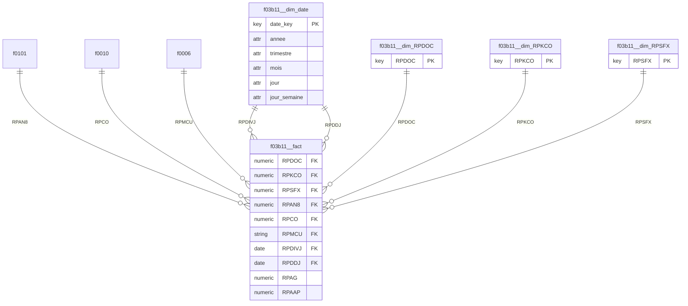

# Kawakiri v3 -- rapport

**Besoin metier** : Analyser les creances clients : montants factures et restant dus par client, societe, centre de cout et date de facture.

**Choix des tables de faits** : hint LLM

> Le besoin porte sur les creances clients : montant facture et montant restant du, par client, societe, centre de cout et date de facture. La table f03b11 (fichier des lignes AR detail) est au grain d'une ligne de facture client (RPDOC/RPSFX) et porte les montants (RPAG = montant brut, RPAAP = montant du/solde) ainsi que les cles client (RPAN8), societe (RPCO/RPKCO), centre de cout (RPMCU) et dates (RPDIVJ, RPDDJ). C'est donc la table de faits a utiliser telle quelle : elle contient deja toutes les mesures necessaires au grain demande, pas besoin d'assemblage. f0006 (centre de cout), f0010 (societe) et f0101 (client) sont des dimensions descriptives, pas des faits.

Liens physiques : 4 retenus sur 6 candidats

| lien | couverture | inverse | statut | decide par | raison |
|---|---|---|---|---|---|
| f0006.MCCO -> f0010.CCCO (N:1) | 100% |  | accepte | LLM (cache) | MCCO (société du centre de coût F0006) et CCCO (société F0010) partagent le même code champ CO = Company ; relation standard JDE entre Business Unit et Company Constants. |
| f03b11.RPAN8 -> f0101.ABAN8 (N:1) | 100% |  | accepte | LLM (cache) | RPAN8 (F03B11, ligne AR) et ABAN8 (F0101, Address Book) partagent le code AN8 = Address Number, qui est la clé standard du client dans JDE. |
| f03b11.RPCO -> f0010.CCCO (N:1) | 100% |  | accepte | LLM (cache) | RPCO (société de la transaction AR) et CCCO (société, F0010) partagent le code CO = Company, lien standard entre transaction et société. |
| f03b11.RPKCO -> f0010.CCCO (N:1) | 100% |  | refuse | LLM (cache) | RPKCO est la société clé du document original (key company), généralement identique à RPCO et redondante ; sa faible cardinalité (5 valeurs) sur une PK à 5 lignes peut recouvrir CCCO par coïncidence plutôt que représenter un second lien indépendant vers la société. |
| f03b11.RPMCU -> f0006.MCMCU (N:1) | 100% |  | accepte | LLM (cache) | RPMCU (centre de coût de la transaction AR) et MCMCU (centre de coût, F0006) partagent le code MCU = Business Unit, lien standard entre transaction et centre de coût. |
| f03b11.RPSFX -> f0010.CCCO (N:1) | 100% |  | refuse | LLM (cache) | RPSFX est le suffixe de paiement (compteur séquentiel, petite plage 0..2), qui recoupe par hasard la clé séquentielle CCCO (5 sociétés) ; aucun sens métier ne relie un suffixe de paiement à une société (indice 2). |

Tokens : 6287 en entree, 1040 en sortie

## f03b11 -- **ok**

Pourquoi cette table : Table de detail des comptes clients (AR) au grain de la ligne de facture : porte les montants factures (RPAG) et restant dus (RPAAP), ainsi que les references client (RPAN8), societe (RPCO/RPKCO), centre de cout (RPMCU) et dates de facture (RPDIVJ/RPDDJ) demandees par le besoin.

Grain : (RPDOC, RPKCO, RPSFX, RPAN8, RPCO, RPMCU, RPDIVJ, RPDDJ) -- unique sur 2617 lignes

Roles de colonnes (LLM) : Grain = une ligne document/facture client (RPDOC/RPSFX). RPDOC, RPDCT, RPKCO, RPSFX forment la clé composite du document (identifiants JDE classiques, non agrégeables). RPAN8 = numéro client (AN8), RPCO = société (CO), RPMCU = centre de coût (MCU) : toutes des entités métier à mettre en dimension. RPDIVJ (date facture) et RPDDJ (date échéance) sont des dates métier, à transformer en clés de dimension date. RPAG = montant brut facturé et RPAAP = montant restant dû (Amount Paid/Open) sont les mesures numériques à agréger, conformément au besoin d'analyse des montants facturés et restant dus. Aucune colonne technique d'ingestion/audit n'est présente dans cette liste.

| colonne | role | decide par | raison |
|---|---|---|---|
| RPDOC | cle extraite (dimension generee) | LLM | aucune table a laquelle se lier : extraite dans f03b11__dim_RPDOC |
| RPDCT | constante (exclue) | statistiques | une seule valeur distincte : n'apporte aucune information |
| RPKCO | cle extraite (dimension generee) | LLM | aucune table a laquelle se lier : extraite dans f03b11__dim_RPKCO |
| RPSFX | cle extraite (dimension generee) | LLM | aucune table a laquelle se lier : extraite dans f03b11__dim_RPSFX |
| RPAN8 | cle etrangere (liee) | LLM | 100% des valeurs retrouvees dans f0101.ABAN8 (sans concordance de nom), lien accepte par : LLM (cache) |
| RPCO | cle etrangere (liee) | LLM | 100% des valeurs retrouvees dans f0010.CCCO (sans concordance de nom), lien accepte par : LLM (cache) |
| RPMCU | cle etrangere (liee) | LLM | 100% des valeurs retrouvees dans f0006.MCMCU (sans concordance de nom), lien accepte par : LLM (cache) |
| RPDIVJ | cle extraite (dimension generee) | LLM | date : jointe au calendrier partage f03b11__dim_date |
| RPDDJ | cle extraite (dimension generee) | LLM | date : jointe au calendrier partage f03b11__dim_date |
| RPAG | mesure | LLM | mesure (LLM) |
| RPAAP | mesure | LLM | mesure (LLM) |

