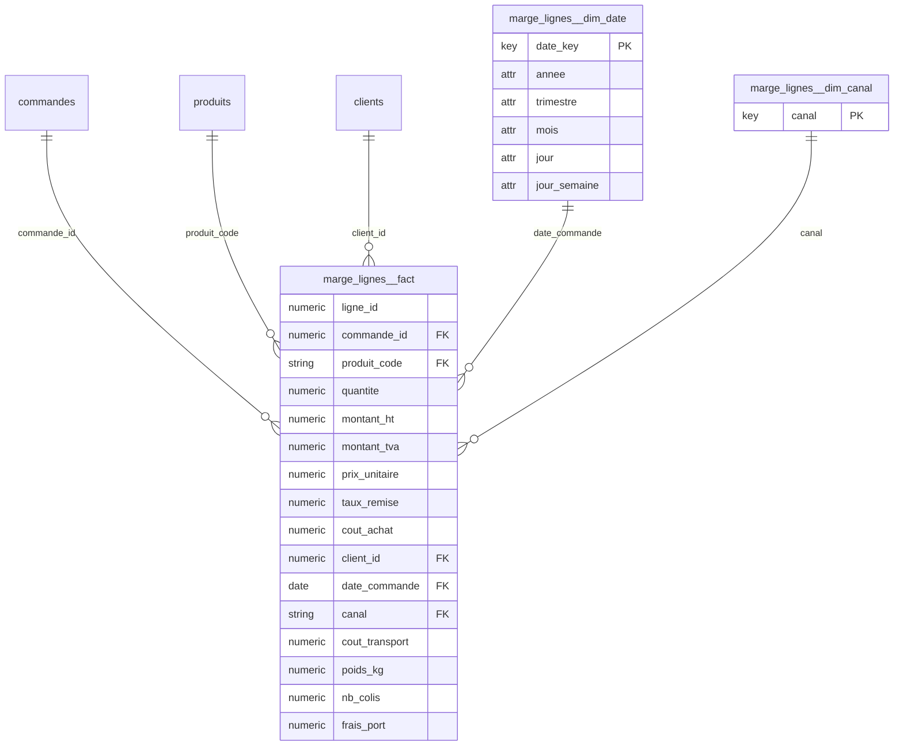

# Kawakiri v3 -- rapport

**Besoin metier** : Analyser la marge brute de chaque ligne de commande.

**Choix des tables de faits** : imposee par l'appelant

Liens physiques detectes (13)

- commandes.client_id -> clients.client_id (N:1, couverture 100%)
- couts_achat.ligne_id -> lignes_commande.ligne_id (1:1, couverture 100%)
- couts_achat.ligne_id -> tarification_lignes.ligne_id (1:1, couverture 100%)
- expeditions.ligne_id -> couts_achat.ligne_id (N:1, couverture 97%)
- expeditions.ligne_id -> lignes_commande.ligne_id (N:1, couverture 100%)
- expeditions.ligne_id -> tarification_lignes.ligne_id (N:1, couverture 100%)
- lignes_commande.commande_id -> commandes.commande_id (N:1, couverture 100%)
- lignes_commande.ligne_id -> couts_achat.ligne_id (1:1, couverture 97%)
- lignes_commande.ligne_id -> tarification_lignes.ligne_id (1:1, couverture 100%)
- lignes_commande.produit_code -> produits.produit_code (N:1, couverture 100%)
- stocks_journaliers.produit_code -> produits.produit_code (N:1, couverture 100%)
- tarification_lignes.ligne_id -> couts_achat.ligne_id (1:1, couverture 97%)
- tarification_lignes.ligne_id -> lignes_commande.ligne_id (1:1, couverture 100%)

## marge_lignes -- **needs_review**

Pourquoi cette table : imposee par l'appelant : une ligne = un produit commande

### Assemblage de marge_lignes

Ancre : `lignes_commande` (7403 lignes), fait assemble : 7403 lignes -- grain attendu : une ligne de commande

| table | relation au grain | chemin |
|---|---|---|
| lignes_commande | ancre (definit le grain) | - |
| tarification_lignes | meme grain | lignes_commande.ligne_id -> tarification_lignes.ligne_id (1:1) |
| couts_achat | meme grain | lignes_commande.ligne_id -> couts_achat.ligne_id (1:1) |
| expeditions | plus fine (agregee) | expeditions.ligne_id -> lignes_commande.ligne_id (N:1) |
| commandes | plus grossiere | lignes_commande.commande_id -> commandes.commande_id (N:1) |

| colonne | source | type | operation | lignes nulles |
|---|---|---|---|---|
| montant_ht | tarification_lignes.montant_ht | mesure | copiee (meme grain) | 0 |
| montant_tva | tarification_lignes.montant_tva | mesure | copiee (meme grain) | 0 |
| prix_unitaire | tarification_lignes.prix_unitaire | mesure | copiee (meme grain) | 0 |
| taux_remise | tarification_lignes.taux_remise | mesure | copiee (meme grain) | 0 |
| cout_achat | couts_achat.cout_achat | mesure | copiee (meme grain) | 208 |
| cout_transport | expeditions.cout_transport | mesure | sum par ligne du grain | 0 |
| poids_kg | expeditions.poids_kg | mesure | sum par ligne du grain | 0 |
| nb_colis | expeditions.colis_id | mesure | count par ligne du grain | 0 |
| client_id | commandes.client_id | cle | copiee | 0 |
| date_commande | commandes.date_commande | cle | copiee | 0 |
| canal | commandes.canal | cle | copiee | 0 |
| frais_port | commandes.frais_port | mesure | repartie au prorata de montant_ht | 0 |

Reconciliation (total de la source contre total du fait assemble) :

| colonne | source | total source | total assemble | ecart | |
|---|---|---|---|---|---|
| montant_ht | tarification_lignes.montant_ht | 2545324.81 | 2545324.81 | +0.00 | ok |
| montant_tva | tarification_lignes.montant_tva | 359647.69 | 359647.69 | -0.00 | ok |
| cout_achat | couts_achat.cout_achat | 1555876.42 | 1555876.42 | -0.00 | ok |
| cout_transport | expeditions.cout_transport | 171102.95 | 171064.90 | -38.05 | ECART |
| poids_kg | expeditions.poids_kg | 134914.31 | 134898.91 | -15.40 | ECART |
| nb_colis | expeditions.colis_id | 10949.00 | 10943.00 | -6.00 | ECART |
| frais_port | commandes.frais_port | 3233.80 | 3233.80 | -0.00 | ok |

Grain : (commande_id, produit_code, client_id, date_commande, canal) -- unique sur 7403 lignes

Avertissements :
- reconciliation de cout_transport : 171064.90 dans le fait assemble contre 171102.95 dans expeditions.cout_transport (ecart -38.05, 0.02%) : des lignes de expeditions ne se rattachent a aucune ligne de lignes_commande
- reconciliation de poids_kg : 134898.91 dans le fait assemble contre 134914.31 dans expeditions.poids_kg (ecart -15.40, 0.01%) : des lignes de expeditions ne se rattachent a aucune ligne de lignes_commande
- reconciliation de nb_colis : 10943.00 dans le fait assemble contre 10949.00 dans expeditions.colis_id (ecart -6.00, 0.05%) : des lignes de expeditions ne se rattachent a aucune ligne de lignes_commande

| colonne | role | decide par | raison |
|---|---|---|---|
| ligne_id | degeneree (reste dans le fait, hors grain) | statistiques | unique sur chaque ligne du fait : identifiant de ligne, hors grain |
| commande_id | cle etrangere (liee) | statistiques | 100% des valeurs retrouvees dans commandes.commande_id (noms concordants) |
| produit_code | cle etrangere (liee) | statistiques | 100% des valeurs retrouvees dans produits.produit_code (noms concordants) |
| quantite | mesure | appelant | mesure (appelant) |
| montant_ht | mesure | appelant | mesure (appelant) |
| montant_tva | mesure | appelant | mesure (appelant) |
| prix_unitaire | mesure | appelant | mesure (appelant) |
| taux_remise | mesure | appelant | mesure (appelant) |
| cout_achat | mesure | appelant | mesure (appelant) |
| client_id | cle etrangere (liee) | appelant | 100% des valeurs retrouvees dans clients.client_id (noms concordants) |
| date_commande | cle extraite (dimension generee) | appelant | date : jointe au calendrier partage marge_lignes__dim_date |
| canal | cle extraite (dimension generee) | appelant | aucune table a laquelle se lier : extraite dans marge_lignes__dim_canal |
| cout_transport | mesure | appelant | mesure (appelant) |
| poids_kg | mesure | appelant | mesure (appelant) |
| nb_colis | mesure | appelant | mesure (appelant) |
| frais_port | mesure | appelant | mesure (appelant) |

