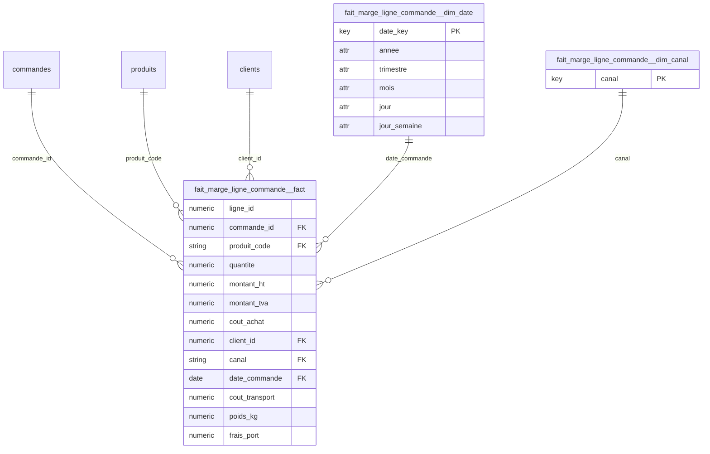

# Kawakiri v3 -- rapport

**Besoin metier** : Analyser la marge brute de chaque ligne de commande : chiffre d'affaires HT, TVA, cout d'achat, couts de transport et poids expedie, ainsi que les frais de port factures au client, par client, produit, canal et date de commande.

**Choix des tables de faits** : hint LLM

> Le besoin porte sur la marge brute par ligne de commande : CA HT, TVA, cout d'achat, cout de transport, poids expedie et frais de port, analyses par client, produit, canal et date de commande. Le grain le plus fin est la ligne de commande (lignes_commande). Aucune table seule ne porte toutes les mesures : le CA HT/TVA est dans tarification_lignes, le cout d'achat dans couts_achat, le cout de transport et poids dans expeditions (plus fin, N expeditions par ligne, donc a agreger par somme), les frais de port et client/canal/date sont dans commandes (plus grossier que la ligne, donc a repartir au prorata du montant_ht), le produit vient de lignes_commande/produits. Il faut donc assembler un fait a partir de lignes_commande comme ancre, en joignant tarification_lignes, couts_achat, expeditions (agrege) et commandes (pour les attributs client/canal/date et l'allocation des frais de port).

Liens physiques detectes (13)

- commandes.client_id -> clients.client_id (N:1, couverture 100%)
- couts_achat.ligne_id -> lignes_commande.ligne_id (1:1, couverture 100%)
- couts_achat.ligne_id -> tarification_lignes.ligne_id (1:1, couverture 100%)
- expeditions.ligne_id -> couts_achat.ligne_id (N:1, couverture 97%)
- expeditions.ligne_id -> lignes_commande.ligne_id (N:1, couverture 100%)
- expeditions.ligne_id -> tarification_lignes.ligne_id (N:1, couverture 100%)
- lignes_commande.commande_id -> commandes.commande_id (N:1, couverture 100%)
- lignes_commande.ligne_id -> couts_achat.ligne_id (1:1, couverture 97%)
- lignes_commande.ligne_id -> tarification_lignes.ligne_id (1:1, couverture 100%)
- lignes_commande.produit_code -> produits.produit_code (N:1, couverture 100%)
- stocks_journaliers.produit_code -> produits.produit_code (N:1, couverture 100%)
- tarification_lignes.ligne_id -> couts_achat.ligne_id (1:1, couverture 97%)
- tarification_lignes.ligne_id -> lignes_commande.ligne_id (1:1, couverture 100%)

Tokens : 5203 en entree, 1043 en sortie

## fait_marge_ligne_commande -- **needs_review**

Pourquoi cette table : Le grain demande est la ligne de commande : chaque ligne represente un produit vendu dans une commande, et c'est a ce niveau que l'on veut analyser la marge brute (CA, TVA, cout d'achat, transport, frais de port). Les mesures sont reparties entre tarification_lignes (CA HT, TVA), couts_achat (cout d'achat), expeditions (cout transport, poids, plus fin donc agrege par ligne), et commandes (frais de port, client, canal, date, plus grossier donc a allouer).

### Assemblage de fait_marge_ligne_commande

Ancre : `lignes_commande` (7403 lignes), fait assemble : 7403 lignes -- grain attendu : Une ligne = un produit (produit_code) vendu dans une commande (lignes_commande.ligne_id), avec sa marge brute (CA HT, TVA, cout d'achat, cout de transport agrege, poids agrege, frais de port alloues), analysable par client, produit, canal et date de commande.

| table | relation au grain | chemin |
|---|---|---|
| tarification_lignes | meme grain | lignes_commande.ligne_id -> tarification_lignes.ligne_id (1:1) |
| couts_achat | meme grain | lignes_commande.ligne_id -> couts_achat.ligne_id (1:1) |
| expeditions | plus fine (agregee) | expeditions.ligne_id -> lignes_commande.ligne_id (N:1) |
| commandes | plus grossiere | lignes_commande.commande_id -> commandes.commande_id (N:1) |
| lignes_commande | ancre (definit le grain) | - |

| colonne | source | type | operation | lignes nulles |
|---|---|---|---|---|
| montant_ht | tarification_lignes.montant_ht | mesure | copiee (meme grain) | 0 |
| montant_tva | tarification_lignes.montant_tva | mesure | copiee (meme grain) | 0 |
| cout_achat | couts_achat.cout_achat | mesure | copiee (meme grain) | 208 |
| cout_transport | expeditions.cout_transport | mesure | sum par ligne du grain | 0 |
| poids_kg | expeditions.poids_kg | mesure | sum par ligne du grain | 0 |
| client_id | commandes.client_id | cle | copiee | 0 |
| canal | commandes.canal | cle | copiee | 0 |
| date_commande | commandes.date_commande | cle | copiee | 0 |
| frais_port | commandes.frais_port | mesure | repartie au prorata de montant_ht | 0 |

Reconciliation (total de la source contre total du fait assemble) :

| colonne | source | total source | total assemble | ecart | |
|---|---|---|---|---|---|
| montant_ht | tarification_lignes.montant_ht | 2545324.81 | 2545324.81 | -0.00 | ok |
| montant_tva | tarification_lignes.montant_tva | 359647.69 | 359647.69 | -0.00 | ok |
| cout_achat | couts_achat.cout_achat | 1555876.42 | 1555876.42 | +0.00 | ok |
| cout_transport | expeditions.cout_transport | 171102.95 | 171064.90 | -38.05 | ECART |
| poids_kg | expeditions.poids_kg | 134914.31 | 134898.91 | -15.40 | ECART |
| frais_port | commandes.frais_port | 3233.80 | 3233.80 | -0.00 | ok |

Grain : (commande_id, produit_code, client_id, canal, date_commande) -- unique sur 7403 lignes

Avertissements :
- reconciliation de cout_transport : 171064.90 dans le fait assemble contre 171102.95 dans expeditions.cout_transport (ecart -38.05, 0.02%) : des lignes de expeditions ne se rattachent a aucune ligne de lignes_commande
- reconciliation de poids_kg : 134898.91 dans le fait assemble contre 134914.31 dans expeditions.poids_kg (ecart -15.40, 0.01%) : des lignes de expeditions ne se rattachent a aucune ligne de lignes_commande

| colonne | role | decide par | raison |
|---|---|---|---|
| ligne_id | degeneree (reste dans le fait, hors grain) | statistiques | unique sur chaque ligne du fait : identifiant de ligne, hors grain |
| commande_id | cle etrangere (liee) | statistiques | 100% des valeurs retrouvees dans commandes.commande_id (noms concordants) |
| produit_code | cle etrangere (liee) | LLM | 100% des valeurs retrouvees dans produits.produit_code (noms concordants) |
| quantite | mesure | statistiques | entier sans lien corrobore par le nom vers une autre table : mesure |
| montant_ht | mesure | LLM | mesure (LLM) |
| montant_tva | mesure | LLM | mesure (LLM) |
| cout_achat | mesure | LLM | mesure (LLM) |
| client_id | cle etrangere (liee) | LLM | 100% des valeurs retrouvees dans clients.client_id (noms concordants) |
| canal | cle extraite (dimension generee) | LLM | aucune table a laquelle se lier : extraite dans fait_marge_ligne_commande__dim_canal |
| date_commande | cle extraite (dimension generee) | LLM | date : jointe au calendrier partage fait_marge_ligne_commande__dim_date |
| cout_transport | mesure | LLM | mesure (LLM) |
| poids_kg | mesure | LLM | mesure (LLM) |
| frais_port | mesure | LLM | mesure (LLM) |

