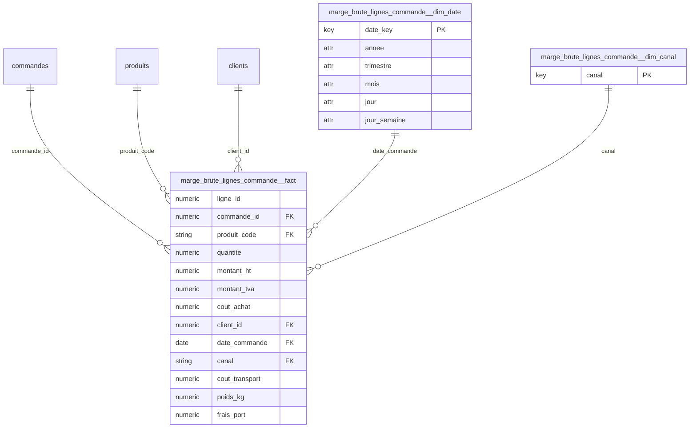

# Kawakiri v3 -- rapport

**Besoin metier** : Analyser la marge brute de chaque ligne de commande : chiffre d'affaires HT, TVA, cout d'achat, couts de transport et poids expedie, ainsi que les frais de port factures au client, par client, produit, canal et date de commande.

**Choix des tables de faits** : hint LLM

> Le besoin porte sur la marge brute par ligne de commande (grain = une ligne de commande), avec mesures reparties sur plusieurs tables : CA HT et TVA (tarification_lignes), cout d'achat (couts_achat), cout de transport et poids (expeditions, qui peut avoir plusieurs colis par ligne -> a agreger par somme), et frais de port facture au client (commandes, au niveau commande -> a repartir au prorata du montant_ht de la ligne). Les dimensions client, produit, canal et date de commande sont portees par des tables plus grossieres (clients via commandes, produits via lignes_commande, canal et date_commande via commandes). Aucune table seule ne porte toutes ces mesures, donc il faut assembler un fait ancre sur lignes_commande.

Liens physiques : 13 retenus sur 24 candidats

| lien | couverture | inverse | statut | decide par | raison |
|---|---|---|---|---|---|
| clients.client_id -> couts_achat.ligne_id (1:1) | 98% | 4% | refuse | statistiques | cle unique couverte dans un seul sens (4% dans l'autre) : coincidence entre deux cles |
| clients.client_id -> lignes_commande.ligne_id (1:1) | 100% | 4% | refuse | statistiques | cle unique couverte dans un seul sens (4% dans l'autre) : coincidence entre deux cles |
| clients.client_id -> tarification_lignes.ligne_id (1:1) | 100% | 4% | refuse | statistiques | cle unique couverte dans un seul sens (4% dans l'autre) : coincidence entre deux cles |
| commandes.client_id -> clients.client_id (N:1) | 100% |  | accepte | noms | noms concordants |
| commandes.client_id -> couts_achat.ligne_id (N:1) | 98% |  | refuse | noms | une autre cible de la meme colonne a un nom concordant |
| commandes.client_id -> lignes_commande.ligne_id (N:1) | 100% |  | refuse | noms | une autre cible de la meme colonne a un nom concordant |
| commandes.client_id -> tarification_lignes.ligne_id (N:1) | 100% |  | refuse | noms | une autre cible de la meme colonne a un nom concordant |
| couts_achat.ligne_id -> lignes_commande.ligne_id (1:1) | 100% |  | accepte | noms | noms concordants |
| couts_achat.ligne_id -> tarification_lignes.ligne_id (1:1) | 100% |  | accepte | noms | noms concordants |
| expeditions.ligne_id -> couts_achat.ligne_id (N:1) | 97% |  | accepte | noms | noms concordants |
| expeditions.ligne_id -> lignes_commande.ligne_id (N:1) | 100% |  | accepte | noms | noms concordants |
| expeditions.ligne_id -> tarification_lignes.ligne_id (N:1) | 100% |  | accepte | noms | noms concordants |
| lignes_commande.commande_id -> commandes.commande_id (N:1) | 100% |  | accepte | noms | noms concordants |
| lignes_commande.ligne_id -> couts_achat.ligne_id (1:1) | 97% |  | accepte | noms | noms concordants |
| lignes_commande.ligne_id -> tarification_lignes.ligne_id (1:1) | 100% |  | accepte | noms | noms concordants |
| lignes_commande.produit_code -> produits.produit_code (N:1) | 100% |  | accepte | noms | noms concordants |
| lignes_commande.quantite -> clients.client_id (N:1) | 100% |  | refuse | LLM (cache) | quantite est une petite plage d'entiers (40 valeurs) ; elle recoupe par hasard la cle sequentielle client_id (1..300). Une quantite commandee ne designe pas un client : coincidence. |
| lignes_commande.quantite -> couts_achat.ligne_id (N:1) | 100% |  | refuse | LLM (cache) | quantite (petite plage d'entiers) recoupe par hasard la cle sequentielle ligne_id de couts_achat. Aucun sens metier a ce qu'une quantite designe une ligne de cout d'achat : coincidence. |
| lignes_commande.quantite -> tarification_lignes.ligne_id (N:1) | 100% |  | refuse | LLM (cache) | quantite (petite plage d'entiers) recoupe par hasard la cle sequentielle ligne_id de tarification_lignes. Pas de relation logique entre une quantite et une ligne de tarification : coincidence. |
| stocks_journaliers.produit_code -> produits.produit_code (N:1) | 100% |  | accepte | noms | noms concordants |
| stocks_journaliers.stock_fin_jour -> lignes_commande.ligne_id (N:1) | 96% |  | refuse | LLM (cache) | stock_fin_jour est un niveau de stock (entier borne, compteur) qui recoupe par hasard la cle sequentielle ligne_id des lignes de commande. Un stock de fin de journee ne designe pas une ligne de commande : coincidence. |
| stocks_journaliers.stock_fin_jour -> tarification_lignes.ligne_id (N:1) | 96% |  | refuse | LLM (cache) | stock_fin_jour (compteur de stock) recoupe par hasard la cle sequentielle ligne_id de tarification_lignes. Pas de lien semantique entre un niveau de stock et une ligne de tarification : coincidence. |
| tarification_lignes.ligne_id -> couts_achat.ligne_id (1:1) | 97% |  | accepte | noms | noms concordants |
| tarification_lignes.ligne_id -> lignes_commande.ligne_id (1:1) | 100% |  | accepte | noms | noms concordants |

Tokens : 5203 en entree, 885 en sortie

## marge_brute_lignes_commande -- **needs_review**

Pourquoi cette table : Le grain demande est la ligne de commande (produit x commande). Les mesures de CA/TVA viennent de tarification_lignes, le cout d'achat de couts_achat, le cout de transport et poids d'expeditions (plusieurs colis possibles par ligne, donc agreges par somme), et les frais de port sont au niveau commande et doivent etre repartis au prorata du montant_ht de la ligne. Client, canal et date de commande proviennent de commandes/clients, le produit de lignes_commande.

### Assemblage de marge_brute_lignes_commande

Ancre : `lignes_commande` (7403 lignes), fait assemble : 7403 lignes -- grain attendu : Une ligne de commande (un produit commande dans une commande donnee)

| table | relation au grain | chemin |
|---|---|---|
| tarification_lignes | meme grain | lignes_commande.ligne_id -> tarification_lignes.ligne_id (1:1) |
| couts_achat | meme grain | lignes_commande.ligne_id -> couts_achat.ligne_id (1:1) |
| expeditions | plus fine (agregee) | expeditions.ligne_id -> lignes_commande.ligne_id (N:1) |
| commandes | plus grossiere | lignes_commande.commande_id -> commandes.commande_id (N:1) |
| lignes_commande | ancre (definit le grain) | - |

| colonne | source | type | operation | lignes nulles |
|---|---|---|---|---|
| montant_ht | tarification_lignes.montant_ht | mesure | copiee (meme grain) | 0 |
| montant_tva | tarification_lignes.montant_tva | mesure | copiee (meme grain) | 0 |
| cout_achat | couts_achat.cout_achat | mesure | copiee (meme grain) | 208 |
| cout_transport | expeditions.cout_transport | mesure | sum par ligne du grain | 0 |
| poids_kg | expeditions.poids_kg | mesure | sum par ligne du grain | 0 |
| client_id | commandes.client_id | cle | copiee | 0 |
| date_commande | commandes.date_commande | cle | copiee | 0 |
| canal | commandes.canal | cle | copiee | 0 |
| frais_port | commandes.frais_port | mesure | repartie au prorata de montant_ht | 0 |

Reconciliation (total de la source contre total du fait assemble) :

| colonne | source | total source | total assemble | ecart | |
|---|---|---|---|---|---|
| montant_ht | tarification_lignes.montant_ht | 2545324.81 | 2545324.81 | -0.00 | ok |
| montant_tva | tarification_lignes.montant_tva | 359647.69 | 359647.69 | -0.00 | ok |
| cout_achat | couts_achat.cout_achat | 1555876.42 | 1555876.42 | -0.00 | ok |
| cout_transport | expeditions.cout_transport | 171102.95 | 171064.90 | -38.05 | ECART |
| poids_kg | expeditions.poids_kg | 134914.31 | 134898.91 | -15.40 | ECART |
| frais_port | commandes.frais_port | 3233.80 | 3233.80 | -0.00 | ok |

Grain : (commande_id, produit_code, client_id, date_commande, canal) -- unique sur 7403 lignes

Avertissements :
- reconciliation de cout_transport : 171064.90 dans le fait assemble contre 171102.95 dans expeditions.cout_transport (ecart -38.05, 0.02%) : des lignes de expeditions ne se rattachent a aucune ligne de lignes_commande
- reconciliation de poids_kg : 134898.91 dans le fait assemble contre 134914.31 dans expeditions.poids_kg (ecart -15.40, 0.01%) : des lignes de expeditions ne se rattachent a aucune ligne de lignes_commande

| colonne | role | decide par | raison |
|---|---|---|---|
| ligne_id | degeneree (reste dans le fait, hors grain) | statistiques | unique sur chaque ligne du fait : identifiant de ligne, hors grain |
| commande_id | cle etrangere (liee) | statistiques | 100% des valeurs retrouvees dans commandes.commande_id (noms concordants) |
| produit_code | cle etrangere (liee) | LLM | 100% des valeurs retrouvees dans produits.produit_code (noms concordants) |
| quantite | mesure | statistiques | entier sans lien corrobore par le nom vers une autre table : mesure |
| montant_ht | mesure | LLM | mesure (LLM) |
| montant_tva | mesure | LLM | mesure (LLM) |
| cout_achat | mesure | LLM | mesure (LLM) |
| client_id | cle etrangere (liee) | LLM | 100% des valeurs retrouvees dans clients.client_id (noms concordants) |
| date_commande | cle extraite (dimension generee) | LLM | date : jointe au calendrier partage marge_brute_lignes_commande__dim_date |
| canal | cle extraite (dimension generee) | LLM | aucune table a laquelle se lier : extraite dans marge_brute_lignes_commande__dim_canal |
| cout_transport | mesure | LLM | mesure (LLM) |
| poids_kg | mesure | LLM | mesure (LLM) |
| frais_port | mesure | LLM | mesure (LLM) |

