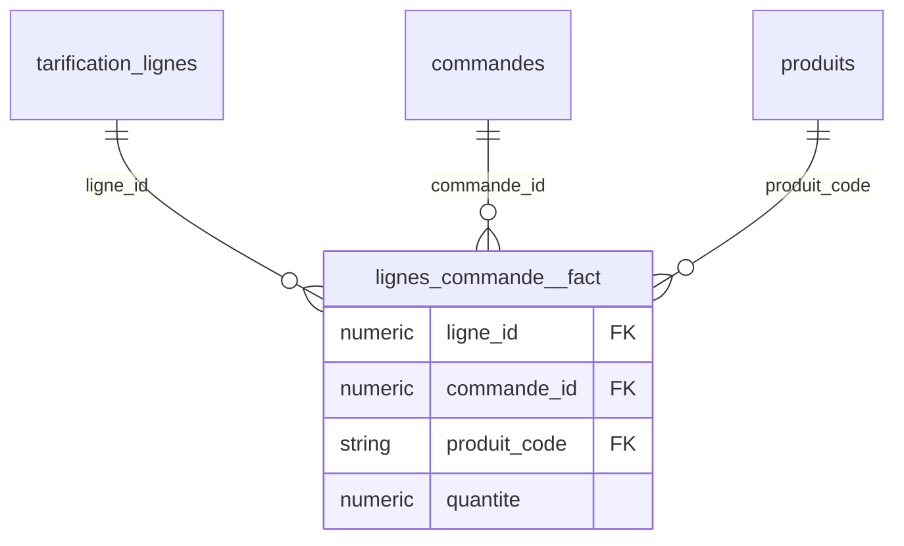

# Kawakiri v3 -- rapport

**Besoin metier** : Analyser la marge brute de chaque ligne de commande.

**Choix des tables de faits** : imposee par l'appelant

## lignes_commande -- **needs_review**

Pourquoi cette table : imposee par l'appelant

Grain : (ligne_id, commande_id, produit_code) -- unique sur 7403 lignes

Avertissements :
- expeditions.ligne_id (10949 lignes) reference lignes_commande.ligne_id (7403 lignes) : le grain demande est peut-etre celui de expeditions

| colonne | role | decide par | raison |
|---|---|---|---|
| ligne_id | cle etrangere (liee) | statistiques | 100% des valeurs retrouvees dans tarification_lignes.ligne_id (noms concordants) |
| commande_id | cle etrangere (liee) | statistiques | 100% des valeurs retrouvees dans commandes.commande_id (noms concordants) |
| produit_code | cle etrangere (liee) | statistiques | 100% des valeurs retrouvees dans produits.produit_code (noms concordants) |
| quantite | mesure | statistiques | entier sans lien corrobore par le nom vers une autre table : mesure |

