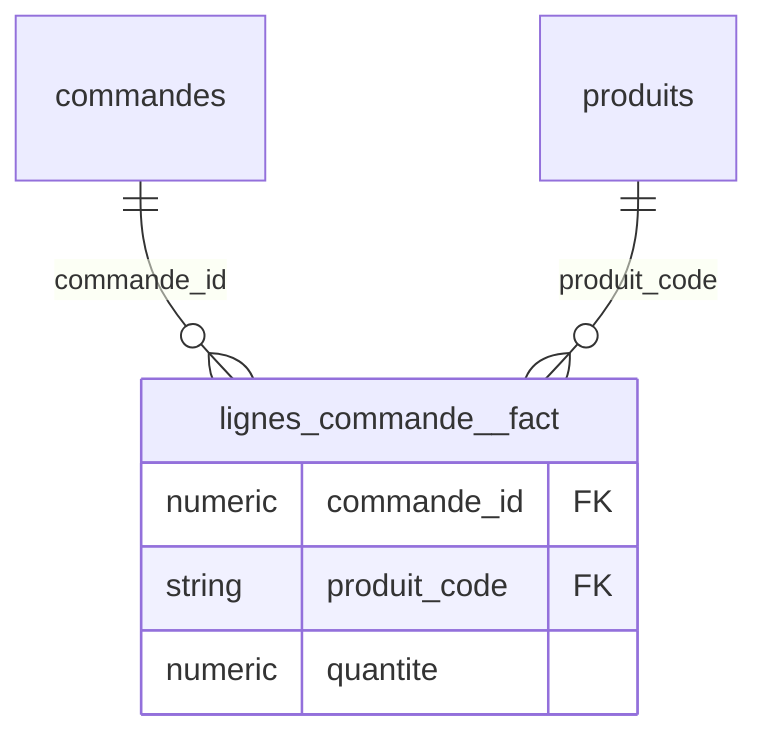

# Kawakiri v3 -- rapport

**Besoin metier** : Analyser la marge brute de chaque ligne de commande : chiffre d'affaires HT, TVA, cout d'achat, couts de transport et poids expedie, ainsi que les frais de port factures au client, par client, produit, canal et date de commande.

**Choix des tables de faits** : hint LLM

> Le besoin porte sur l'analyse de la marge brute au grain de la ligne de commande : CA HT, TVA, cout d'achat, couts de transport/poids expedie, et frais de port, ventile par client, produit, canal et date de commande. La table 'lignes_commande' est la table au grain le plus fin (une ligne = un produit commande dans une commande), mais les mesures financieres (montant_ht, montant_tva), les couts d'achat et les couts de transport/poids sont repartis dans des tables satellites liees par ligne_id (tarification_lignes, couts_achat, expeditions), tandis que les frais de port et le canal/date sont portes par 'commandes'. Comme le modele doit etre construit a partir d'une seule table dont chaque colonne non identifiante devient une dimension, il faut designer 'lignes_commande' comme table de faits principale car elle represente l'evenement central (une ligne de commande = produit x quantite), point de jonction naturel vers produit, commande (donc client, canal, date) et vers les mesures de cout/tarification/transport qui seront rattachees via ligne_id lors du modelage automatique.

Tokens : 4875 en entree, 911 en sortie

## lignes_commande -- **ok**

Pourquoi cette table : Chaque ligne represente un produit commande au sein d'une commande (produit_code, quantite), ce qui correspond exactement au grain d'analyse demande pour la marge brute par client/produit/canal/date. Cette table est le pivot naturel reliant commandes (client, canal, date, frais de port), produits, et les tables de mesures financieres (tarification_lignes, couts_achat) et logistiques (expeditions) via ligne_id.

Grain : (commande_id, produit_code) -- unique sur 7403 lignes

Roles de colonnes (LLM) : ligne_id est la clé technique unique de la ligne de commande (identifiant de la table de faits elle-même, sans rôle d'analyse) ; commande_id et produit_code sont des identifiants d'entités métier (commande et produit) qui deviendront des clés de dimension ; quantite est une mesure numérique à agréger (quantité commandée).

| colonne | role | decide par | raison |
|---|---|---|---|
| ligne_id | technique (exclue) | LLM | exclue (LLM) : colonne technique |
| commande_id | cle etrangere (liee) | LLM | 100% des valeurs retrouvees dans commandes.commande_id (noms concordants) |
| produit_code | cle etrangere (liee) | LLM | 100% des valeurs retrouvees dans produits.produit_code (noms concordants) |
| quantite | mesure | LLM | mesure (LLM) |

